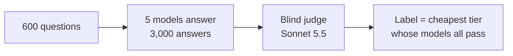

# Tier routing: final conclusion

> **TL;DR** — 16 router runs were tested on 600 questions whose tiers were **measured** with real models, not guessed. **None routes well.** The best is a statistical tie: d3-flash zero-shot at **48.3%** balanced accuracy (chance = 33.3%), and Jev with a threshold chosen by cross-validation at **48.6%**.
> Models fine-tuned on **authored** labels fall from 74–77% on the authored test to 42–44% here. They learned the guesses, not real difficulty.

## 📁 Data used

| Data | Questions | Labels | Used for |
|---|---:|---|---|
| **Measured 600** (`data/llm_tier_selection_600_measured.jsonl`) | **600**: 300 authored + 300 OpenAssistant oasst2 (English) | **Measured:** LOW **376** / MID **140** / HIGH **84** | **Test set** for every model |
| `eval_600` (not included) | 600 | Authored: 200 per tier | Training the fine-tuned and retrained models |
| Authored 300 (not included) | 300 | Authored: 100 per tier | The earlier test, shown for comparison |

**Measuring the labels:**

| Tier | Models (all must pass) |
|---|---|
| **LOW** | `gpt-4.1-nano` + `Qwen3.5 9B` |
| **MID** | `gpt-4.1` + `Gemma 4 26B-A4B` |
| **HIGH** | `gpt-5.4` |

- **Unsolved questions:** the 11 questions no tier solved are labelled HIGH.
- **Cost:** `$9.23` of API calls; the judge ran on the Claude plan.

## 📊 Comparison

Ranked by **balanced accuracy** on the measured 600, which weights every tier equally (33.3% = chance).

| Model | Version | Params | **Balanced** | Accuracy | Recall low / mid / high | Too small | Too big | **Threshold by cross-validation** | Authored 300 | p50 latency |
|---|---|---:|---:|---:|---|---:|---:|---:|---:|---:|
| **d3-flash** (tied best) | **zero-shot** | **8.4 B** | **48.3%** | **50.5%** | **46 / 85 / 14%** | **15.2%** | **34.3%** | 45.0% | 45.7% | 682 ms |
| **Jev** (tied best with threshold) | **zero-shot (hosted)** | **n/p** | **45.6%** | **59.5%** | **71 / 65 / 1%** | **22.0%** | **18.5%** | **48.6%** | **33.7%** | **299 ms** |
| d3-flash | fine-tuned | 8.4 B | 43.6% | 35.8% | 29 / 36 / 66% | 6.5% | 57.7% | 44.1% | **76.7%** | ~0.7 s |
| CLM | fine-tuned | 8.2 B | 41.6% | 32.5% | 26 / 25 / 74% | **5.5%** | 62.0% | 41.4% | 73.7% | 114 ms |
| CLM | zero-shot | 8.2 B | 38.9% | 51.3% | 68 / 20 / 29% | 24.3% | 24.3% | 36.9% | 38.3% | 116 ms |
| Laya typed-decisions | fine-tuned | 421 M | 38.6% | 29.5% | 15 / 62 / 38% | 9.5% | 61.0% | 42.0% | 41.3% | 46 ms |
| PR-292 (MiniLM) | retrained | 23 M | 37.9% | 29.0% | 21 / 32 / 61% | 8.3% | 62.7% | 37.1% | 58.0% | 2.8 ms |
| Laya English | fine-tuned | 421 M | 37.7% | 28.7% | 20 / 34 / 60% | 7.8% | 63.5% | 37.0% | 53.7% | 45 ms |
| PR-296 semantic | retrained | 33 M | 37.0% | 28.5% | 20 / 35 / 56% | 9.2% | 62.3% | 36.4% | 57.0% | 4.1 ms |
| PR-296 lexical | retrained | < 1 M | 35.0% | 25.3% | 17 / 28 / 61% | 7.7% | 67.0% | 37.2% | 53.7% | 0.2 ms |
| **Nasiko main** | online feedback | 0 (rules) | 33.8% | 28.7% | 14 / 84 / 4% | 16.7% | 54.7% | — | — | < 0.1 ms |
| **Nasiko main** | cold start | 0 (rules) | 33.4% | 42.2% | 51 / 38 / 12% | 25.0% | 32.8% | — | — | < 0.1 ms |
| Laya multilingual | fine-tuned | 322 M | 33.1% | 25.3% | 16 / 41 / 43% | 11.8% | 62.8% | 30.0% | 38.7% | 20 ms |
| Laya, 3 bases | zero-shot | 322–421 M | 31.4–33.3% | ~23% | almost all MID | ~14% | ~63% | 31.8–37.5% | ~33% | 20–45 ms |
| *Always LOW* | *baseline* | — | *33.3%* | *62.7%* | *100 / 0 / 0%* | *37.3%* | *0%* | — | *33.3%* | — |

*n/p = not published.*
- *"Threshold by cross-validation" is the honest tuned score: the rule and threshold are chosen on 4 of 5 folds and applied to the 5th.*
- *"Authored 300" is each model's plain accuracy on the authored 300 set. That set is balanced (100 per tier), so it's comparable with balanced accuracy here.*
- *d3-flash's fine-tuned latency includes the backbone.*
- *Laya's fine-tunes vary from run to run on the Mac GPU (by up to 3.6 points); the latest runs are shown.*

## 🔍 Conclusions

1. **No router tested routes measured difficulty well.** The best honest scores are 48.3–48.6%, against 33.3% for chance and 100% for perfect routing. A bootstrap test can't separate d3-flash and Jev: the difference is +0.3 points, 95% interval −4.3 to +5.0.
2. **Zero-shot beats fine-tuned on authored labels.** d3-flash drops from 48.3% to 43.6% once it's fine-tuned. Every model trained on `eval_600` sends too many questions to HIGH: 132–317, where only 84 need it.
3. **The authored labels are the problem.** Most questions authored as MID or HIGH are solved by today's LOW models. That's why fine-tuned d3-flash scores **76.7%** on the authored test but **43.6%** on the measured one.
4. **Nasiko's current router is at chance (33–34%).** It has no difficulty signal: a regex request type plus random sampling. Best-case feedback only moves it to MID for everything.
5. **Size helps, but not enough.** The 8 B models lead, yet at about the cost of answering with a LOW model. The tiny PR models (23–33 M, a few ms) sit near chance.
6. **Honestly chosen thresholds add at most about 3–5 points** (Jev +3.0 to 48.6%), and some models lose. Thresholds tuned on the authored set don't transfer: Jev's 0.95 scored 66.3% there but 46.5% here.

## 🚀 Next steps

> [!TIP]
> 1. **Train on measured labels:** 5-fold cross-validation on this 600 set for d3-flash's readout, CLM's heads, the PR models and Laya. This tests whether measured difficulty can be learned at all.
> 2. **Measure a separate training set** (about `$10` plus judging), for a clean train / test split.
> 3. **Judge self-agreement check** on about 100 items, to bound the label noise.

*Full details: [RESULTS.md](RESULTS.md) (all tables, thresholds, sizes, glossary).*
