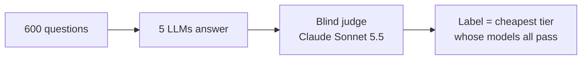

# Router selection dataset

> **TL;DR** — 600 English questions, each labelled with the **model tier it really needs** (LOW / MID / HIGH). The labels were measured with real LLMs and a blind judge, not guessed. Tiers: LOW **376** / MID **140** / HIGH **84**.
> 16 router runs were tested on it, and **none picks the right tier reliably**. The best is a tie at **~48%** balanced accuracy, where chance is 33%.

## 📦 The dataset

**File:** [`data/llm_tier_selection_600_measured.jsonl`](data/llm_tier_selection_600_measured.jsonl), one JSON object per line:

```json
{"query": "What does a 70% chance of rain in a forecast actually mean, and what does it not mean?", "label": "MID", "topic": "science_environment", "word_count": 18}
```

| Field | Meaning |
|---|---|
| `query` | The question, as a user would ask it |
| `label` | **Measured tier:** `LOW`, `MID` or `HIGH` |
| `topic` | One of 16 broad domains, e.g. `software_coding`, `math` or `law_government` |
| `word_count` | Length in words: 6–148, median 19 |
| `reference_answer` | A verified answer, on 19 questions only |

**Sources:**
- **300 questions** written for this set. They're balanced on length, writing style, question type and domain, so the tier can't be guessed from surface cues.
- **300 real prompts** from [OpenAssistant oasst2](https://huggingface.co/datasets/OpenAssistant/oasst2) (Apache-2.0). They're English and filtered for quality, safety and time-sensitivity.

## ⚙️ How the labels were measured



| Tier | Models (all must pass) |
|---|---|
| **LOW** | `gpt-4.1-nano` + `Qwen3.5 9B` |
| **MID** | `gpt-4.1` + `Gemma 4 26B-A4B` |
| **HIGH** | `gpt-5.4` |

- **Blind grading:** the 3,000 answers were anonymised and shuffled into 60 batches. Each batch was graded in a fresh judge session with no tools.
- **Cut-off answers:** answers that hit the token limit were re-run with a higher limit.
- **Unsolved questions:** the 11 questions no tier solved are labelled HIGH.
- **Cost:** `$9.23` of API calls.

## 📊 Routers tested on it

| Router | Bal. % | Acc. % | Recall % L/M/H | Under % | Over % | p50 | Size |
|---|---:|---:|---:|---:|---:|---:|---:|
| **d3-flash zero-shot** (tie) | **48.3** | 50.5 | 46/85/14 | 15.2 | 34.3 | 682 ms | 8.4 B |
| **Jev + threshold**† (tie) | **48.6** | 54.0 | 59/54/33 | 14.3 | 31.7 | 299 ms | n/p |
| Jev zero-shot | 45.6 | **59.5** | 70/65/1 | 22.0 | **18.5** | 299 ms | n/p |
| d3-flash fine-tuned | 43.6 | 35.8 | 29/36/66 | 6.5 | 57.7 | ~0.7 s | 8.4 B |
| CLM fine-tuned | 41.6 | 32.5 | 26/25/74 | **5.5** | 62.0 | 114 ms | 8.2 B |
| Laya fine-tuned (best of 3) | 38.6 | 29.5 | 15/62/38 | 9.5 | 61.0 | 46 ms | 421 M |
| PR-292 (MiniLM) | 37.9 | 29.0 | 21/32/61 | 8.3 | 62.7 | 2.8 ms | 23 M |
| PR-296 semantic / lexical | 37.0 / 35.0 | 28.5 / 25.3 | — | 9.2 / 7.7 | 62.3 / 67.0 | 4.1 / 0.2 ms | 33 M / < 1 M |
| Nasiko router (main) | 33.4 | 42.2 | 50/38/12 | 25.0 | 32.8 | < 0.1 ms | rules |
| *Always LOW* | 33.3 | 62.7 | 100/0/0 | 37.3 | 0 | — | — |

**Columns:**
- **Bal.:** balanced accuracy, the average recall over the three tiers.

  ```
  Bal. = (Recall LOW + Recall MID + Recall HIGH) / 3      # 33.3% = chance
  ```

- **Under / Over:** routed to a cheaper tier than measured (answer at risk) / to a dearer one (money wasted).
- **p50:** median time per decision on a Mac (M5 Pro); for Jev, the API round trip.
- **Size:** parameters; n/p = not published.

† **Jev + threshold:** if Jev's confidence in its pick is below 0.7, send the question to HIGH. The threshold was chosen by 5-fold cross-validation, so no question is scored with a threshold picked using its own label.

**Takeaways:**
- **The best two are statistically tied:** the difference is +0.3 points, with a 95% interval from −4.3 to +5.0.
- **Fine-tuning hurts:** models trained on an older set with **hand-written** tiers send too many questions to HIGH.
- **Nasiko's router is at chance:** it has no difficulty signal.

Full tables, threshold sweeps and the glossary are in [`RESULTS.md`](RESULTS.md). The brief version is [`REPORT.md`](REPORT.md), and the one-page version is [`CONCLUSION.md`](CONCLUSION.md).

## 📁 Repository layout

| Path | What it is |
|---|---|
| [`data/llm_tier_selection_600_measured.jsonl`](data/llm_tier_selection_600_measured.jsonl) | **The dataset** |
| [`results/`](results/) | One `<router>.json` per run, with its metrics, setup and notes |
| [`results/predictions/`](results/predictions/) | Every router's pick for every question, with probabilities where the router gives them |
| [`results/thresholds/`](results/thresholds/) | The best threshold per router, including the cross-validated ones |
| [`results/logs/`](results/logs/) | The console log of every run |
| [`REPORT.md`](REPORT.md) | Brief report |
| [`CONCLUSION.md`](CONCLUSION.md) | One-page conclusion |
| [`RESULTS.md`](RESULTS.md) | Full results: every table, the threshold sweeps, model sizes and a glossary |

## ⚠️ Caveats

- **Judge noise:** 46% of the fails are "unsure" grades (score 0.4–0.6). A judge self-agreement check hasn't been run.
- **HIGH rests on one model** (`gpt-5.4`), and each model answered each question once.
- **The tiers are relative to these models.** As small models improve, questions move down a tier.

## 📜 License

- **The 300 authored questions and the results:** MIT, see [`LICENSE`](LICENSE).
- **The 300 oasst2 prompts:** from OpenAssistant/oasst2, Apache-2.0.
- **Model answers and router outputs:** generated by the models and services named above (OpenAI, Qwen, Gemma, Claude, TypeSafe Jev), under their providers' terms.
