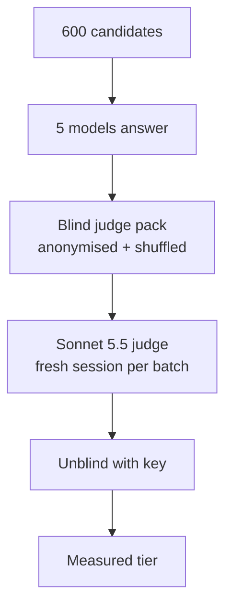

# Measured tiers for the 600-question candidate pool

> **TL;DR** — 5 models answered all 600 candidates (3,000 answers, `$9.23` API), and Claude Sonnet 5.5 graded every answer blind. The measured tiers are **376 LOW / 140 MID / 73 HIGH / 11 NONE**.
> The authored labels match the measured tier on only **43%** of the 300 authored questions. LOW is right **93%** of the time, but most MID and HIGH questions are **easier than labelled**: today's small models solve them.

## 🎯 Goal

The authored LOW / MID / HIGH labels were guesses. This run replaces each guess with a **measurement**: the cheapest tier of real models that actually answers the question correctly.

## ⚙️ How it works

**Models per tier:** one OpenAI model and one open-source model wherever possible.

| Tier | OpenAI | Open-source (local, MLX 4-bit) |
|---|---|---|
| **LOW** | `gpt-4.1-nano` | `Qwen3.5 9B` |
| **MID** | `gpt-4.1` | `Gemma 4 26B-A4B` |
| **HIGH** | `gpt-5.4` | — (no frontier open model fits a 24 GB Mac) |

**Tier rule:**
- **Strict:** a tier passes only when **every** model in that tier passes.
- **Measured tier** = the **cheapest** tier that passes.
- **NONE** = even HIGH failed.
- **Borderline** = the two models of a tier disagree.

## 🧪 How it was run

**Answers** (`answer.py`)
- Each model answered every candidate.
- Temperature was 0 for the non-reasoning OpenAI models, `gpt-5.4` used default settings, and Qwen ran with thinking switched off.
- Answers that hit the 2,000-token limit were re-answered with **6,000 tokens**.
  - **7 answers still hit the limit.** All are real failures, so they are graded as they are:
    - `Qwen3.5 9B` (6): it went in circles on a problem, or once repeated `import torch` in a loop.
    - `gpt-4.1` (1): a dinosaur tweet that became "AAAA…".
- `gpt-4.1` replaced `gpt-4.1-mini` as the MID OpenAI model. Mini's answers are kept in `answers_unused/` and not graded.

**Judge** (`make_judge_pack.py`, `run_judge.py`)
- **Anonymised and shuffled:** the 3,000 answers have random IDs and are mixed across 60 batches of 50. The model key is kept outside the repo.
- **Isolated:** each batch is graded in its own `claude -p --model claude-sonnet-5-5` session:
  - `--tools ""`: no file, web or shell access;
  - `--safe-mode`: no `CLAUDE.md`, memory, hooks or MCP;
  - `--no-session-persistence`: nothing carries over between batches.
- **Rubric:** `JUDGE_INSTRUCTIONS.md` grades the substance of an answer, not its style or length.
  - A wrong result, a missing part or a cut-off answer is a fail.
  - When the judge is unsure, it fails the answer with a score of 0.4–0.6.
- **No reference answers** were written for this run; the 19 questions that already had one used it.
- **Checked:** every item got exactly one grade.
  - 4 batches skipped 1–2 items on the first try.
  - Only the missing items were re-sent, each in a fresh session.

## 📊 Results

### Measured tiers

| Measured tier | Authored | oasst2 | **Total** |
|---|---:|---:|---:|
| **LOW** | 204 | 172 | **376** |
| **MID** | 62 | 78 | **140** |
| **HIGH** | 31 | 42 | **73** |
| **NONE** | 3 | 8 | **11** |
| **Total** | **300** | **300** | **600** |

### Authored labels against measured tiers

| Authored ↓ / Measured → | LOW | MID | HIGH | NONE | **Match** |
|---|---:|---:|---:|---:|---:|
| **LOW** | **93** | 5 | 2 | 0 | **93%** |
| **MID** | 70 | **18** | 10 | 2 | **18%** |
| **HIGH** | 41 | 39 | **19** | 1 | **19%** |
| **Total** | 204 | 62 | 31 | 3 | **43.3%** |

### Pass rate by model (600 answers each)

| Model | Tier | **Passed** | Rate |
|---|---|---:|---:|
| `gpt-4.1-nano` | LOW | 479 | 79.8% |
| `Qwen3.5 9B` | LOW | 407 | **67.8%** |
| `gpt-4.1` | MID | 553 | 92.2% |
| `Gemma 4 26B-A4B` | MID | 520 | 86.7% |
| `gpt-5.4` | HIGH | 583 | **97.2%** |

## 🔍 Findings

**1. The authored MID and HIGH labels have drifted.** 70 of the 100 authored MID questions and 41 of the 100 authored HIGH questions are measured **LOW**: both small models answer them correctly. Examples of authored HIGH questions measured LOW:
- How many integers from 1 to 1,000,000 are neither perfect squares nor perfect cubes?
- Why does bread go stale faster in the fridge than on the counter?
- How do astronomers read an exoplanet's atmosphere from starlight?

**2. Authored LOW holds up.** 93 of 100 are measured LOW. The 7 misses are everyday requests where a LOW model's answer was graded a fail, such as a fair chore chart for three roommates, or a city walk that ends by 5 pm.

**3. `Qwen3.5 9B` is the weak link for LOW.** It drives most of the **207 borderline questions**:

| Borderline split | Questions |
|---|---:|
| LOW: nano pass, **Qwen fail** | **103** |
| LOW: Qwen pass, nano fail | 31 |
| MID: `gpt-4.1` pass, **Gemma fail** | **53** |
| MID: Gemma pass, `gpt-4.1` fail | 20 |
| **Total** | **207** |

Under the strict rule, Qwen alone pushes 103 questions above LOW.

**4. NONE mostly means badly posed, not too hard.** Examples:

| Question | Why every tier failed |
|---|---|
| Rewrite a resume bullet "to show impact" | No numbers are given, so every answer either invents metrics or is "unquantified" |
| Two weeks in "four countries" with a wheelchair | The countries aren't named, so `gpt-5.4` only asked clarifying questions |
| Social-credit scores for real people | A loaded request: models refused or scored arbitrarily |
| CI/CD for marketing vs developers | A real trick question: in marketing, CI/CD is Corporate Identity / Corporate Design |

> [!TIP]
> Drop the 11 NONE questions from any final set; they measure the question, not the model.

## ⚠️ Caveats

> [!WARNING]
> - **Judge noise:** 210 of the 458 fails (**46%**) are "unsure" fails, scored 0.4–0.6. Grades near tier boundaries are the least reliable. A **self-agreement check** (re-grading a sample in fresh sessions) has **not been run yet**.
> - **24 out-of-order results:** a lower tier passed where a higher tier failed. 16 of them are "LOW passes, MID fails". The cheapest-tier rule still gives each a tier, but they point to judge noise or single-answer variance.
> - **HIGH rests on one model** (`gpt-5.4`), so HIGH borderline cases can't be detected.
> - **One answer per model per question.** A rerun of the same question can come out differently: `gpt-4.1-mini` failed x² − 13y² = 1 once, then solved it on a rerun.
> - **No reference answers** for most checkable questions (math, logic), so the judge solved them itself while grading.
> - **Judge temperature can't be set** through `claude -p`; the default is used.

## 💰 Cost

| Item | Cost |
|---|---:|
| `gpt-4.1-nano` | `$0.10` |
| `gpt-4.1` | `$2.46` |
| `gpt-5.4` | `$6.67` |
| `Qwen3.5 9B`, `Gemma 4 26B-A4B` (local) | `$0.00` |
| **Total for the answers used** | **`$9.23`** |

Also spent, but not used in the results: the dropped `gpt-4.1-mini` run (`$0.47`) and the replaced cut-off answers (about `$0.12`). The judge ran on the Claude Team plan, with no per-token cost.

## 📁 Files

| File | What it is |
|---|---|
| `answer.py` | Gets every model's answers (`--redo-capped`, `--max-tokens` for cut-off reruns) |
| `make_judge_pack.py` | Builds the anonymised, shuffled judge pack and the key |
| `run_judge.py` | Runs the isolated Sonnet judge, one session per batch, with retries for skipped items |
| `measure_tiers.py` | Unblinds the grades and applies the tier rule |
| `JUDGE_INSTRUCTIONS.md` | The judge's rubric |
| `answers/` | 5 × 600 answers |
| `grades/` | 3,000 grades, plus `raw/` (the judge's full replies) |
| `measured_tiers.jsonl` | Measured tier, per-tier pass flags and authored label for every question |
| `~/.cache/xroutebench/judge_key.json` | Which model wrote each item (outside the repo) |

## 🚀 Next steps

1. **Self-agreement check:** re-grade about 100 items, weighted towards unsure fails and borderline questions, to measure judge stability.
2. **Build the final balanced set** from the measured tiers, without the NONE and (optionally) borderline questions.
   - HIGH has only **73** measured questions, so a 100-per-tier set needs about 27 more hard questions. The alternative is a smaller balanced set, such as 70 per tier.
3. **Optional second HIGH model,** so HIGH borderline cases become visible too.
